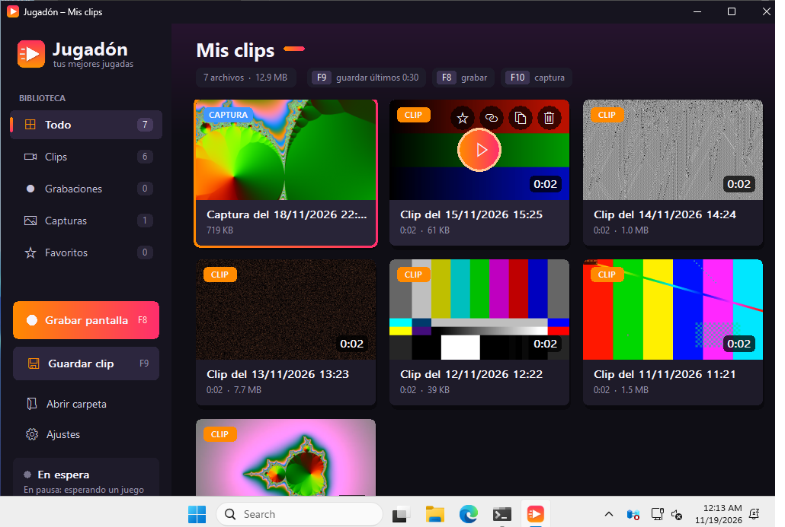

# Jugadón

**Clips de juegos para Windows 10 y 11, pensado para PCs de pocos recursos.** Hecho en Rust, sin cuentas y sin internet. Mientras jugás, Jugadón recuerda los últimos segundos; cuando hacés una jugada buena apretás **F9** y queda guardada como `.mp4`.

- 🎮 **F9 guarda la jugada.** Los últimos 15 s, 30 s, 1, 2 o 5 minutos (vos elegís), con un "tin-tin" de confirmación.
- ⏺️ **F8 graba de principio a fin**: la pantalla completa o **una sola ventana** (el juego, el navegador o cualquier otra), aunque tengas otra cosa adelante.
- 📸 **F10 saca una captura** en `.png`.
- 🔊 **Sonido del juego y tu micrófono.**
- 🗂️ **Ventana "Mis clips"** con miniaturas: abrís, compartís (con el menú Compartir de Windows), copiás para pegar en Discord o WhatsApp, o borrás.
- ⚡ **El video lo comprime la placa de video** (NVENC, AMF, Quick Sync o, si el driver es viejo, a través de Windows), no el procesador. Sin juego abierto queda en pausa y no consume nada.
- 🌍 **Anda en cualquier PC con Windows 10 u 11**, con cualquier placa y cualquier driver: si una forma de grabar no funciona, prueba sola la siguiente.
- 🔒 **No se conecta a internet** ni manda datos a ningún lado. Tus clips quedan solo en tu PC.

## Instalar

1. Entrá a **[Releases](../../releases/latest)** y bajá `Jugadon-windows-x64.zip`.
2. Descomprimilo en una carpeta, por ejemplo `C:\Jugadon`. Tienen que quedar juntos `jugadon.exe` y `ffmpeg.exe`.
3. Abrí `jugadon.exe`.

**Windows puede decir "Windows protegió su PC"** porque el programa no está firmado (la firma digital es un certificado pago). Tocá **Más información → Ejecutar de todas formas**.

Jugadón aparece como un ícono en la bandeja del sistema, al lado del reloj. Si no lo ves, tocá la flechita `^`.

| Ícono | Qué significa |
|---|---|
|  naranja | Clips activos: F9 guarda los últimos segundos |
| gris | En pausa: no hay ningún juego abierto, no consume nada |
| 🔴 rojo | Grabando con F8 (al pasar el mouse muestra el tiempo) |

## Teclas

| Tecla | Qué hace |
|---|---|
| **F9** | Guarda los últimos segundos como clip |
| **F8** | Empieza a grabar la pantalla completa / la frena y la guarda |
| **F10** | Captura de pantalla |

Las teclas se cambian en el menú → Opciones (se pueden combinar con Ctrl, Alt o Shift). Todo se guarda en `Videos\Jugadon`. Al guardar aparece un aviso: tocalo y se abre el archivo.

## Cómo funciona

**Clips (F9).** Para poder guardar "lo que pasó recién", Jugadón va grabando siempre los últimos segundos y tira lo más viejo. **Los clips no se guardan solos:** solo cuando apretás F9. En el menú → **Clips en segundo plano** elegís cuándo funciona esa memoria:

- **Solo mientras juego** (viene así): se activa cuando una ventana tapa toda la pantalla (juego en pantalla completa o "ventana sin bordes") y se pausa cuando volvés al escritorio, 1 minuto después, así un alt-tab rápido no te borra el clip. Jugadón no lee la memoria del juego ni se mete en él: solo mira qué ventana está activa, y Windows le avisa cuando cambia.
- **Siempre**: funciona todo el tiempo.
- **Apagado**: no graba nada por su cuenta; solo grabás con F8.

**Grabación (F8).** Graba hasta que la frenás con F8, y queda como `grabacion_….mp4`. Para grabar una sola ventana: menú → **Grabar una ventana** y la elegís de la lista. Mientras grabás con F8, los clips en segundo plano se pausan, así nunca graba dos veces lo mismo. Si se corta la luz o se cuelga la PC, lo grabado se recupera solo la próxima vez que abrís Jugadón.

## Ventana "Mis clips"

Se abre con **clic izquierdo** en el ícono (o con `jugadon.exe --clips`, útil para un acceso directo). Muestra tus clips, grabaciones y capturas con miniatura, del más nuevo al más viejo, y arriba el estado, cuántos archivos hay y cuánto ocupan.

Botones: **Abrir** (también doble clic) · **Compartir…** (WhatsApp, correo, dispositivos cercanos…) · **Copiar** (para pegar con Ctrl+V en Discord o WhatsApp) · **Mostrar en carpeta** · **Eliminar** (va a la papelera) · **Abrir carpeta**.

Está hecha con los controles propios de Windows, sin un navegador por dentro. Solo existe mientras está abierta: **cerrarla con la X la libera entera** y Jugadón sigue en la bandeja. Las miniaturas salen del caché del Explorador de Windows y se cargan de a una con prioridad baja.

## Menú (clic derecho en el ícono)

- **Estado** (arriba de todo): grabando y con qué, en pausa o error.
- **Ver mis clips…**, **Guardar clip**, **Captura**, **Grabar pantalla completa**, **Grabar una ventana ▸**, **Copiar último clip**.
- **Clips en segundo plano ▸**: Solo mientras juego / Siempre / Apagado.
- **Duración del clip ▸**: 15 s, 30 s, 1 min, 2 min o 5 min.
- **Calidad ▸**:
  - **Automática** (recomendada): 720p 30 fps si comprime la placa; 480p 30 fps si tiene que usar el procesador.
  - O la elegís: 480p 30 fps (ahorro máximo), 720p 30 fps, 720p 60 fps.
- **Opciones ▸**: grabar micrófono (activado), sonido al guardar, **nunca usar el procesador** (desactivado), cambiar teclas, iniciar con Windows.
- **Abrir carpeta**, **Salir**.

La configuración está en `%APPDATA%\Jugadon\config.ini`. Ahí también se puede cambiar la carpeta de salida (`folder=`).

## Rendimiento: por qué no se siente en el juego

- **En reposo no hay nada grabando.** Sin juego abierto, `ffmpeg.exe` ni siquiera corre y Jugadón devuelve su memoria a Windows. Medido en los servidores de GitHub: **108 KB** de RAM y menos de 40 ms de CPU en 25 segundos.
- **El video lo comprime la placa**, en su chip de video dedicado, aparte de lo que usa el juego para dibujar. La imagen se achica a 720p dentro de la placa y nunca pasa por el procesador.
- **Siempre prueba primero la placa**, de todas las formas posibles. El procesador se usa solo si ninguna anda, y a 480p con prioridad baja. Si preferís que en ese caso no grabe, activá Opciones → **Nunca usar el procesador**.
- **Guardar un clip no recomprime nada.** Los últimos segundos están en el disco en pedazos de 2 s y F9 solo los une en un `.mp4`, con prioridad baja. Por eso no hay tirón al guardar.
- **El juego siempre tiene prioridad**: la grabación corre con prioridad "debajo de lo normal", y guardar o capturar con prioridad "baja".
- **Audio liviano**: el modo rápido de AAC. Medido: **1,6 % de un núcleo** para el audio y el guardado de pedazos.
- **Nada de video en la RAM**: el buffer está en el disco, unos 1,5 MB cada 2 s a 30 fps (230 MB con 5 minutos), y se borra al salir.

Mientras grabás, el que usa memoria es `ffmpeg.exe` (tiene abierta la captura y el compresor de la placa), como en cualquier programa que grabe la pantalla. Fijate los números reales en el Administrador de tareas: "Jugadón" y "ffmpeg.exe".

### PCs de bajos recursos (por ejemplo i3-2100 con 4 GB)

Lo que define si se nota es **quién comprime el video**. Jugadón prueba solo, en este orden, y se queda con lo más liviano que funcione en tu PC:

| Tu PC | Quién comprime | Qué esperar |
|---|---|---|
| NVIDIA GTX 600 o más nueva (no la GT 710/1030), AMD con VCE/VCN | El chip de video de la placa | No deberías notar bajón de FPS |
| Gráficos Intel con Quick Sync (el i3-2100 lo trae) | Intel Quick Sync | Bajo impacto |
| Cualquiera de las anteriores con un driver viejo | La misma placa, a través de Windows (Media Foundation) | Igual de liviano |
| Ninguna placa que comprima video | El procesador (salvo que actives "Nunca usar el procesador") | 480p 30 fps, un solo hilo, prioridad baja. En 2 núcleos se puede notar algo |

Si pasás el mouse por el ícono, te dice cuál está usando. Con drivers sin la captura moderna de Windows (por ejemplo Intel HD 2000/3000 en Windows 10), captura por GDI, que funciona en cualquier PC; igual intenta que comprima la placa. Lo que anduvo se recuerda para la próxima vez.

## Problemas comunes

- **"Windows protegió su PC"**: Más información → Ejecutar de todas formas.
- **El ícono queda gris y F9 no guarda nada**: no detectó un juego en pantalla completa. Poné el juego en "pantalla completa" o "ventana sin bordes", o elegí Clips en segundo plano → **Siempre**.
- **Dice que la placa no puede comprimir**: solo pasa si activaste Opciones → Nunca usar el procesador. Desactivalo, o actualizá el driver de video.
- **Otro programa usa F9, F8 o F10**: Jugadón avisa; cambiá la tecla desde Opciones.
- **Un juego en pantalla completa exclusiva sale negro**: ponelo en "ventana sin bordes".
- **Cualquier otra cosa**: mirá `%TEMP%\jugadon.log`.

## Límites

- Graba el **monitor principal** (o una ventana).
- "Grabar una ventana" necesita **Windows 10 versión 2004** o más nuevo. Si minimizás la ventana, el video queda congelado hasta que la volvés a mostrar.
- Audio del sistema y micrófono van mezclados en una sola pista.
- Sin HDR: con HDR activado los colores pueden salir lavados.

## Desinstalar

1. Menú → Opciones → desmarcá **Iniciar con Windows**, y después menú → **Salir**.
2. Borrá la carpeta donde descomprimiste Jugadón y `%APPDATA%\Jugadon`.
3. Tus clips quedan en `Videos\Jugadon` hasta que los borres vos.

## Compilación

Todo se compila en GitHub Actions (`.github/workflows/release.yml`) con cada cambio en `main`. El workflow corre los tests, incluidas grabaciones reales con ffmpeg. Compila `jugadon.exe` con su ícono y baja FFmpeg 8.1, verificando que tenga `ddagrab`, `gfxcapture`, `scale_d3d11`, NVENC, AMF, QSV y x264. Después mide la RAM en reposo, le saca una foto a la ventana "Mis clips" y publica el zip en Releases. El ícono y el banner se generan con `assets/make_assets.py`.

## Licencias

Jugadón: MIT. `ffmpeg.exe` es FFmpeg (GPLv3); el zip incluye `FFMPEG-LICENCIA.txt` con la licencia y el link al código fuente.
